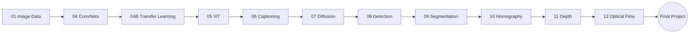

# 👁️ Computer Vision

A hands-on series from basic image handling to transformers, diffusion models, 3D geometry and motion.

| # | Module | Notebook (latest run) | Open |
|:-:|---|---|:-:|
| 01 | Working with Image Data | [1_WorkingWithImageData_FlavioCorrea](1_WorkingWithImageData_FlavioCorrea.ipynb) |  |
| 04 | Intro to ConvNets | [4_IntroToCovNetsForCV_FlavioCorreaMar052026_549PM](4_IntroToCovNetsForCV_FlavioCorreaMar052026_549PM.ipynb) |  |
| 04B | Transfer Learning & Augmentation | [4B_TransferLearningDataAugmentation_FlavioCorrea_2026_Mar08](4B_TransferLearningDataAugmentation_FlavioCorrea_2026_Mar08.ipynb) |  |
| 05 | Vision Transformers | [5_Image_Classification_with_Vision_Transformer](5_Image_Classification_with_Vision_Transformer_FlavioCorrea_11Mar2026.ipynb) |  |
| 06 | Autoencoders & Image Captioning | [6_Autoencoder_Image_Captioning](Copy_of_6_Autoencoder_Image_Captioning_FlavioCorrea_run2026Mar12_1211PM.ipynb) |  |
| 07 | Diffusion Models (DDIMs) | [7_IntroductionToDDIMs](7_IntroductionToDDIMs.ipynb) |  |
| 08 | Object Detection | [8_ObjectDetection_Flavio_Correa_2026Apr03](8_ObjectDetection_Flavio_Correa_2026Apr03.ipynb) |  |
| 09 | Semantic Segmentation | [9_SemanticSegmentation](9_SemanticSegmentation_FlavioCorrea_2026Apr08_run444PM.ipynb) |  |
| 10 | Homography & Projections | [10_HomographyProjections (11:27 PM run)](10_HomographyProjections_16Apr2026_run1127PM.ipynb) |  |
| 11 | Monocular Depth Estimation | [11_Monocular_Depth_Estimation](11_Monocular_Depth_Estimation_Flavio_Correa_runApr22_1022AM.ipynb) |  |
| 12 | Optical Flow | [12_OpticalFlow](12_OpticalFlow_Flavio_Correa_run_May3rd_840PM.ipynb) |  |
| 🏁 | Final Project | [Project_FlavioCorrea_2026Apr09_1137PM](Project_FlavioCorrea_2026Apr09_1137PM.ipynb) |  |

> Earlier runs of some modules are also in this folder; the table links the most recent one.

[⬅ Back to portfolio](../README.md)
